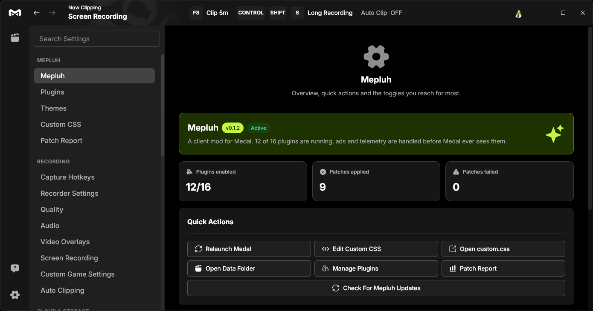

[](https://github.com/fr1zs/mepluh)

<p align="center"><b>A fix for Mepluh, a mod for Medal</b></p>

<p align="center">
  <a href="#features">Features</a> · <a href="#one-command-install">Install</a> · <a href="#plugins">Plugins</a> · <a href="#themes">Themes</a>
</p>

---



## Features

- 🚫 **No ads.** Every ad slot, sponsored card and promo campaign removed.
- 🕵️ **No telemetry.** Analytics, session replay and crash reporting are blocked.
- ⚙️ **Native settings.** Mepluh lives inside Medal's own settings, built with Medal's own components.
- 🔄 **One-click updates.** Check for updates and patch Medal straight from the Mepluh settings tab.
- 🎨 **Themes.** Catppuccin, AMD, Transparency, your own `.css` files or any theme URL, applied live.
- 🫧 **Liquid Glass.** Refractive, light-reactive glass with Windows 11 Acrylic and Mica backdrops.
- ✏️ **Custom CSS.** A built-in Monaco editor with autocomplete and live preview.
- ⏩ **Arrow seeking.** Scrub through clips using the keyboard arrow keys.
- 🔍 **Screenshot zoom.** Zoom and pan into screenshots instead of copying on click.
- 🎬 **Start on clips.** Launch straight into your clips library on startup instead of the home feed.
- 🖥️ **Desktop game detection.** Categorizes Screen Recording clips under the running game, if any.
- 📂 **Keep edits in game folder.** Keeps edited clips inside the game folder instead of the Edits folder.
- 🔌 **Clips Only.** Strip away social feeds and online clutter.
- 🎮 **Discord Rich Presence.** Broadcast your Medal activity directly to your Discord profile.
- 🔊 **Unlocked sound alerts.** Access restricted sound alerts right out of the box.

## One Command Install

*Requires Windows (PowerShell) and Medal. ([Bun](https://bun.sh) is installed automatically if missing)*   
  
**Run this command in a non-admin Powershell window:**

```sh
irm https://raw.githubusercontent.com/fr1zs/mepluh/main/install.ps1 | iex

```

Open Medal's settings and look for the **Mepluh** section.

Mepluh has a built in updater, so when it updates it all you have to to is press a button and it should be good to go!

To remove Mepluh, run `bun run uninject`

## Plugins (17)

| Plugin | What it does |
| --- | --- |
| NoAds | Removes every ad slot and blocks Medal's ad session. |
| NoPromotions | Removes sponsored cards, promo announcements and campaign banners. |
| NoTelemetry | Blocks Amplitude, session replay, Sentry and LaunchDarkly uploads. |
| WindowEffects | Liquid Glass, Acrylic and Mica window backdrops. |
| CustomCSS | Applies `%APPDATA%\Mepluh\custom.css` live. |
| FeatureFlags | Overrides Medal's feature flags. |
| DevTools | Opens DevTools with F12 or Ctrl+Shift+I. |
| ArrowSeek | Seeks forward and backward in clips using the arrow keys. |
| ScreenshotZoom | Zooms and pans into screenshots on click or scroll instead of copying, and adds a copy button. |
| StartOnClips | Opens directly to your clips library on launch and prevents home-page redirects. |
| DesktopGameDetect | Categorizes Screen Recording clips under the running game whenever Medal detects a game alongside desktop capture. |
| KeepEditsInGameFolder | Saves trimmed and edited clips in the original clip's game folder instead of moving them to the Edits folder. |
| HideOnlineFeatures | Hides social, feed, and online-only tabs for a local-first experience. |
| NoAutoUpdate | Prevents Medal from automatically downloading and installing updates. |
| RichPresence | Displays your current Medal activity on Discord Rich Presence. |
| Settings | Integrates Mepluh's configuration tab natively into Medal's settings. |
| UnlockSoundAlerts | Unlocks restricted sound alerts and audio effects. |

## Themes

Drop any `.css` file into `%APPDATA%\Mepluh\themes` and enable it under **Mepluh → Themes**. Online themes work too: just paste a link.

Built in: **OLED**, **Transparency**, **AMD Red** and **Catppuccin** (Latte, Macchiato, Mocha). Change the Catppuccin accent with `:root { --ctp-accent: var(--ctp-pink); }` in Custom CSS.

## ORIGINAL PROJECT
https://github.com/prettylittlelies/mepluh